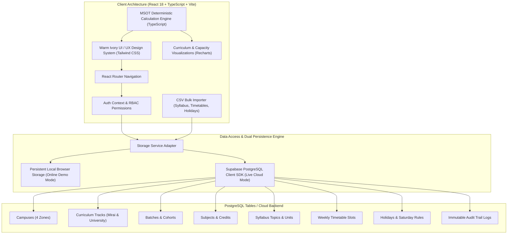

# MSOT Course Progression Tracker (MVP)

A college course progression and syllabus delivery platform designed for academic administrators, campus managers, faculty members, and students. It tracks curriculum delivery, timetable capacity, Indian academic calendar rules (including 2nd & 4th Saturday holidays), buffer ratios, examination readiness, and unlogged class escalations.

---

## 1. System Overview & Aesthetic Design System

### Design Philosophy
The user interface implements an editorial aesthetic built with generous whitespace, rounded cards, clean charts, and no generic templates:
- **Warm Ivory Background**: `#FAF5E9` (`bg-[#FAF5E9]`)
- **Charcoal Sidebar**: `#202020` (`bg-[#202020]`) with warm text accents
- **Pastel Pink**: `#F3B5D8` (Used for `DANGER` status, urgent alerts, and &gt;48h escalations)
- **Butter Yellow**: `#F5DE75` (Used for `TIGHT` status, timetable slot chips, and primary action buttons)
- **Powder Blue**: `#BFD4F3` (Used for future timetable capacity, student portal chips, and examination scopes)
- **Sage Green**: `#C4D59B` (Used for `ON TRACK` and `COMPLETE` progression statuses and covered hours)
- **Modern Typography**: Plus Jakarta Sans paired with Inter.
- **Card Aesthetics**: Rounded 2xl/3xl cards (`border border-[#E8DFC9]` with soft elevation).

---

## 2. Architecture Diagram



---

## 3. Exact Mathematical Formulas

The platform implements deterministic, mathematical calculations in [`src/utils/calculations.ts`](file:///Users/aanyavarshney/Desktop/course_tracker/src/utils/calculations.ts):

### A. Hours in Scope
$$\text{Hours in Scope} = \sum_{\text{topic} \notin \text{skipped}} \text{topic.planned\_hours}$$
*Skipped topics are explicitly excluded from syllabus scope.*

### B. Covered Hours
$$\text{Covered Hours} = \sum \begin{cases} \text{planned\_hours} & \text{if completed} \\ \text{planned\_hours} \times \frac{\text{completion\_pct}}{100} & \text{if in progress} \\ 0 & \text{if not started or skipped} \end{cases}$$

### C. Coverage Percentage & Remaining Hours
$$\text{Coverage Percentage} = \frac{\text{Covered Hours}}{\text{Hours in Scope}} \times 100$$
$$\text{Remaining Hours} = \max(0, \text{Hours in Scope} - \text{Covered Hours})$$

### D. Teaching Buffer Ratio & Progression Status
$$\text{Buffer Ratio} = \frac{\text{Available Teaching Hours before Target Date}}{\text{Remaining Hours}}$$

| Status Condition | Criteria | UI Styling |
| :--- | :--- | :--- |
| **COMPLETE** | Remaining Hours $\le 0.001$ (or 100% covered) | Sage Green (`#C4D59B`) |
| **ON TRACK** | Buffer Ratio $\ge 1.15$ | Sage Green (`#C4D59B`) |
| **TIGHT** | $1.00 \le \text{Buffer Ratio} < 1.15$ | Butter Yellow (`#F5DE75`) |
| **DANGER** | $\text{Buffer Ratio} < 1.00$ | Pastel Pink (`#F3B5D8`) |

### E. Track Status Worst-Case Rule
The overall academic track status reflects the **worst-performing subject** rather than an average:
$$\text{Severity: } \text{DANGER} > \text{TIGHT} > \text{ON TRACK} > \text{COMPLETE}$$

### F. Available Teaching Hours (Zero Double-Counting)
Available teaching hours count future timetable capacity strictly between the current simulation date and the target finish date.
- It iterates each calendar day.
- Checks if the day falls within semester boundaries.
- Respects Saturday rules (`all`, `none`, or `second_fourth`). Under `second_fourth`, 2nd and 4th Saturdays of each month are holidays.
- Skips declared holidays and non-teaching days.
- Sums timetable slots assigned to that weekday.
- Completed hours belong to `Covered Hours`; future slots belong to `Available Hours`. The sets never intersect, avoiding double counting.

### G. Pace vs Plan
$$\text{Pace vs Plan} = \text{Covered Hours} - \sum_{\substack{\text{topic} \notin \text{skipped} \\ \text{planned\_date} \le \text{today}}} \text{topic.planned\_hours}$$

### H. Overdue Topics
$$\text{Overdue Topic} \iff (\text{topic.planned\_date} < \text{today}) \land (\text{topic.status} \notin \{\text{completed}, \text{skipped}\})$$

---

## 4. Key Features Walkthrough

1. **Faculty Dashboard & Fast Session Logging**:
   - **Today's Timetable Widget**: Directly highlights active classes scheduled for today with a 1-click "Log Session" button.
   - **All 5 Session Statuses Supported**:
     1. Conducted / Completed
     2. Partially Completed
     3. Cancelled (automatically triggers planned date recalculations)
     4. Rescheduled / Substitute
     5. Skipped / Non-teaching
   - Granular topic completion sliders, classwork/homework notes, carry-forward agenda, and quick-add topic directly to the syllabus inside the modal.

2. **Admin Setup & CSV Bulk Importer**:
   - Pre-configured setup for **4 Campuses** (`HI-Tech`, `Ratnam`, `RGIB`, `JUJ`), **2 Tracks** (`Mirai Track`, `University Track`), Semesters, Timetables, and Holidays.
   - **CSV Bulk Importer**: Includes downloadable templates, live file upload or paste, automated schema validation, and 1-click commit for:
     1. Syllabus Topics CSV
     2. Timetable Slots CSV
     3. Academic Holidays CSV

3. **Automatic Topic Planned Dates Recalculation**:
   - Sequentially allocates syllabus topic hours onto future available timetable slots across eligible working days.
   - Skips declared holidays and non-working Saturdays.
   - Automatically shifts topic planned dates whenever a class is marked `cancelled` or a holiday is declared.

4. **Academic Progression Command Center (Dashboard)**:
   - Displays Planned, Covered, Remaining, and Available hours with two decimal place precision.
   - Highlights the mandatory **Worst-Subject Track Rule**.
   - Clean Recharts visualization in sage green, butter yellow, and powder blue.

5. **Exam Readiness Engine**:
   - Computes examination readiness strictly isolating the **explicit syllabus scope** of that exam rather than the entire course.
   - Displays in-scope coverage, remaining hours before exam date, available class capacity, and urgent attention topics.

6. **Student Portal (Read-Only)**:
   - Verified student view of delivered topics, in-progress topics, and upcoming topics with target completion dates.
   - Upcoming exam schedules and tested topic counts.

7. **Campus Manager Overdue Escalations**:
   - Tracks unlogged sessions with hours overdue.
   - Allows sending immediate reminders to faculty for unlogged classes.
   - Automatically flags and escalates unlogged sessions exceeding **48 hours**.

---

## 5. Seeded Data Summary

- **Primary Active Campus**: `HI-Tech` (Hyderabad Tech Zone)
- **Primary Active Batch**: `B.Tech CSE 2024-28 (Sec A)` (Mirai Track, Semester 3)
- **Three Monitored Subjects**:
  1. `CS301` — Data Structures & Algorithms (Dr. Radhika Sharma) — **ON TRACK**
  2. `CS302` — Database Management Systems (Prof. Arvind Menon) — **TIGHT**
  3. `CS303` — Computer Networks & Security (Dr. Priya Nair) — **DANGER**
- **Other Campuses Seeded**: `Ratnam` (Bangalore), `RGIB` (Pune), `JUJ` (Noida).
- **Other Track Seeded**: `University Track`.

---

## 6. Fast Demo Personas

On the login page, click any of the 4 demo persona buttons for 1-click instant login:

| Persona | Name | Role | Scope |
| :--- | :--- | :--- | :--- |
| **Administrator** | Dr. Suresh Chandra | `admin` | Full control across all 4 campuses, tracks, calendar rules, CSV importer, and reset. |
| **Campus Manager** | Vikramaditya Roy | `campus_manager` | HI-Tech campus oversight, overdue log escalations (&gt;48h), and reminders. |
| **Faculty Member** | Dr. Radhika Sharma | `faculty` | Assigned to CS301; quick session logging and syllabus editing. |
| **Student** | Rohan Varma | `student` | Read-only portal for B.Tech CSE Sec A syllabus and exam dates. |

---

## 7. Setup & Running Locally

### Prerequisites
- Node.js v18+ (tested on Node v26.11.1)
- npm v9+

### Commands
```bash
# 1. Install dependencies
npm install

# 2. Run automated test suite (25 tests across 4 suites)
npm run test

# 3. Run concurrency load test (50, 100, 200 users)
npx vite-node src/test/loadTest.ts

# 4. Run Vite development server
npm run dev

# 5. Build production bundle
npm run build
```

---

## 8. Actual Concurrency Load Test Benchmark

Executed via [`src/test/loadTest.ts`](file:///Users/aanyavarshney/Desktop/course_tracker/src/test/loadTest.ts):

| Metric | 50 Users | 100 Users | 200 Users |
| :--- | :--- | :--- | :--- |
| **Requests** | 500 | 1,000 | 2,000 |
| **Total Duration** | 46.03 ms | 73.29 ms | 145.83 ms |
| **Throughput** | **10,863.43 RPS** | **13,645.16 RPS** | **13,714.94 RPS** |
| **Avg Latency** | 0.092 ms | 0.073 ms | 0.073 ms |
| **p95 Latency** | 0.130 ms | 0.080 ms | 0.075 ms |
| **p99 Latency** | 0.442 ms | 0.109 ms | 0.095 ms |
| **Success Rate** | **100.0%** | **100.0%** | **100.0%** |

---

## 9. Known Limitations & Roadmap

1. **Email / SMS Dispatch**: In local demo mode, faculty missed-log reminders simulate notifications within the in-app audit trail and local state. A webhook adapter (e.g. Resend or Twilio) can be connected for external email/WhatsApp delivery.
2. **Bi-directional Calendar Sync**: The app calculates and generates academic calendar events. Direct sync with Google Calendar or Microsoft Outlook via iCal/.ics export can be added as a next-phase feature.
3. **Complex Multi-Period Slot Merging**: Currently, double-period classes are represented as single slots with duration = 2.0 or 3.0 hours. Split multi-room lab allocations are handled on a per-slot basis.
